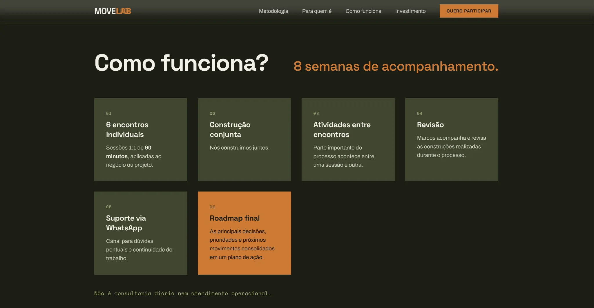

<div align="center">

[🇺🇸 English](./README.md) · [🇧🇷 Português](./README.pt-BR.md) · **🇪🇸 Español**

# MOVE LAB — Landing page responsiva

**Desarrollo frontend sin frameworks para una experiencia de mentoría en marketing, growth y estrategia digital.**

[Ver demostración](https://marcuscastrodev.github.io/move-lab/) · [Perfil del desarrollador](https://github.com/marcuscastrodev)

</div>

## Resumen

Este repositorio es una adaptación independiente para portafolio de una landing page de marketing. Se centra en la jerarquía de contenidos, la experiencia móvil y la conversión usando **HTML, CSS y JavaScript puro**, sin framework frontend.

## Galería

### 01 — Landing page de escritorio

Portada con tipografía expresiva, cuadrícula sutil y llamada principal a la acción.


### 02 — Cómo funciona

Tarjetas que explican el acompañamiento durante ocho semanas, desde sesiones individuales hasta la hoja de ruta final.



### 03 — Landing page móvil

Adaptación de titulares, navegación, ancho y CTA para pantallas pequeñas.


## Funcionalidades

- Diseño responsivo y navegación móvil personalizada.
- Control de menú accesible con `aria-expanded` y cierre con Escape.
- Cabecera reactiva al desplazamiento y CTA móvil.
- Animaciones de aparición que respetan el movimiento reducido.
- Formulario con validación en el navegador **solo como demostración**.

## Decisiones de frontend

- **Sin framework:** HTML, CSS y JavaScript para una página enfocada.
- **Responsividad:** tipografías, espacios, navegación y tarjetas adaptables.
- **Conversión:** propuesta de valor y acciones destacadas.
- **Accesibilidad:** estados de navegación, teclado y movimiento reducido.
- **Identidad:** tipografía expresiva, cuadrícula y acentos naranjas sobre fondo oscuro.

## Tecnologías

HTML5 · CSS3 · JavaScript puro · Google Fonts

Fuentes: Space Grotesk, Archivo y Space Mono.

## Ejecución local

Abre `index.html` en un navegador o ejecuta:

```bash
python3 -m http.server 8000
```

Después visita `http://localhost:8000`.

## Importante: formulario de ejemplo

**No se envía, guarda ni procesa información.** El formulario bloquea el envío y muestra un mensaje de demostración. Para producción serían necesarios un endpoint real, protección de datos y pruebas completas.

## Notas de implementación

La exportación original incluía etiquetas como `x-dc`, `sc-if`, `{{ ... }}` y una dependencia `support.js` ausente. Esta adaptación las reemplaza con marcado, estilos e interacciones independientes conservando la dirección visual.

## Mi papel

Concepto, estrategia digital e implementación web en colaboración con **EMI Marketing e Conteúdo**.

## Mejoras futuras

- Pruebas entre navegadores y dispositivos.
- Auditoría de accesibilidad manual y automatizada.
- Revisión de capturas después de futuros cambios.
- Integración real del formulario si fuera necesaria.

---

Desarrollado por [Marcus Castro](https://github.com/marcuscastrodev).
