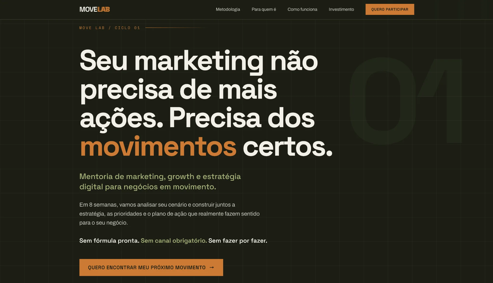
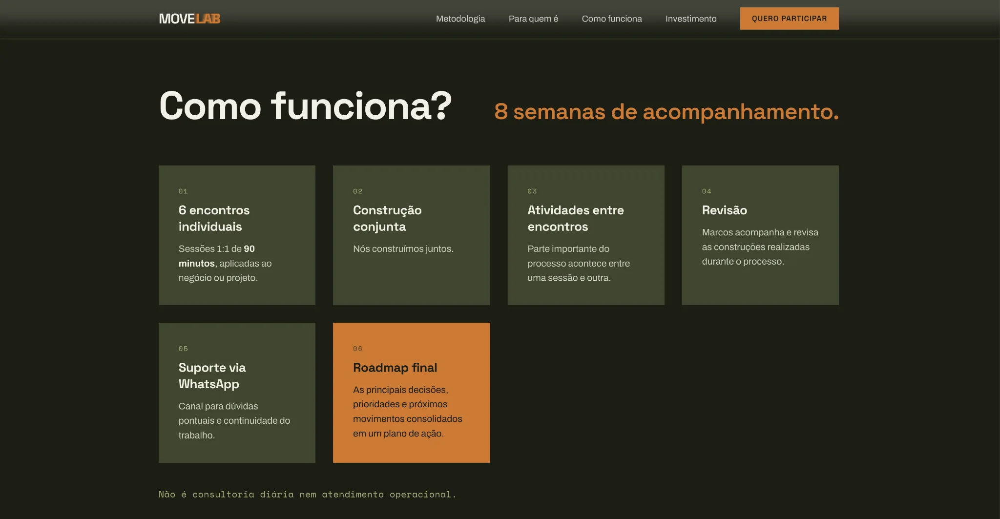

<div align="center">

**🇺🇸 English** · [🇧🇷 Português](./README.pt-BR.md) · [🇪🇸 Español](./README.es.md)

</div>

# MOVE LAB | Responsive Landing Page

A responsive, framework-free landing page for **MOVE LAB**, a marketing, growth and digital strategy mentorship initiative.

**[View live demo →](https://marcuscastrodev.github.io/move-lab/)** · **[Developer profile](https://github.com/marcuscastrodev)**

## Overview

This repository is a standalone portfolio adaptation of a marketing landing page. It focuses on a clear content hierarchy, mobile usability, and a conversion-oriented interface, using HTML, CSS, and vanilla JavaScript without a frontend framework.

## Interface gallery

### 01 — Desktop landing page

The opening section uses a strong typographic hierarchy, a dark grid-based background, and a focused call to action to introduce the mentorship.



### 02 — How it works

A modular card grid outlines the eight-week mentorship journey, from one-on-one sessions to the final action roadmap.



### 03 — Mobile landing page

The mobile layout adapts the headline, navigation, content width, and CTA to a narrow viewport.


## Frontend decisions

- **Framework-free implementation:** maintainable HTML, CSS, and JavaScript for a focused landing page.
- **Responsive layout:** adaptive typography, spacing, navigation, and card presentation.
- **Conversion hierarchy:** prominent value proposition and consistent calls to action.
- **Accessible interactions:** navigation state conveyed with `aria-expanded`, keyboard dismissal, and respect for reduced-motion preferences.
- **Visual identity:** expressive typography, subtle grid texture, and orange highlights against a dark background.

## Features

- Responsive custom layout and mobile navigation
- Accessible navigation toggle with `aria-expanded` and Escape-key handling
- Scroll-aware header and mobile call to action
- Scroll-triggered reveal animations, with reduced-motion preference respected
- Application form with client-side validation **for demonstration only**

## Technologies

HTML5 · CSS3 · Vanilla JavaScript · Google Fonts

Fonts used: Space Grotesk, Archivo, and Space Mono.

## Run locally

Open `index.html` in a browser, or serve the project locally:

```bash
python3 -m http.server 8000
```

Then visit `http://localhost:8000`.

## Important: demo form

**No submissions are sent, stored, or processed.** The form prevents submission and displays an explicit demonstration message. A production application would require a real submission endpoint, privacy handling, and end-to-end tests.

## Implementation notes

The original export contained custom template tags and expressions, including `x-dc`, `sc-if`, `{{ ... }}`, and a missing `support.js` dependency. This portfolio adaptation replaces those runtime dependencies with standalone markup, styles, and interactions while preserving the visual direction.

## My role

Concept, digital strategy, and web implementation in collaboration with **EMI Marketing e Conteúdo**.

## Further improvements

- Cross-browser and device testing
- Automated and manual accessibility review
- Verify screenshots against future design updates
- Production-ready form integration, if needed

---

Built by [Marcus Castro](https://github.com/marcuscastrodev).
