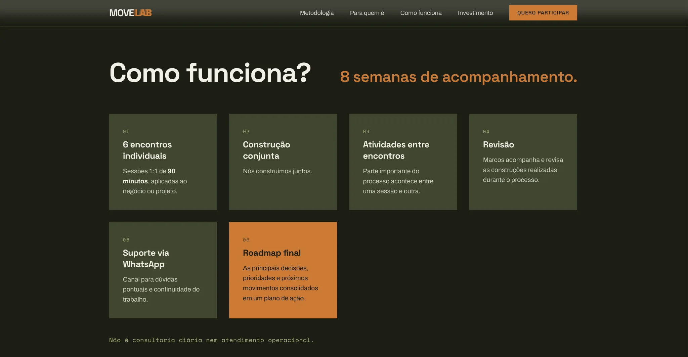

<div align="center">

[🇺🇸 English](./README.md) · **🇧🇷 Português** · [🇪🇸 Español](./README.es.md)

# MOVE LAB — Landing page responsiva

**Desenvolvimento frontend sem framework para uma experiência de mentoria em marketing, growth e estratégia digital.**

[Ver demonstração](https://marcuscastrodev.github.io/move-lab/) · [Perfil do desenvolvedor](https://github.com/marcuscastrodev)

</div>

## Visão geral

Este repositório é uma adaptação independente para portfólio de uma landing page de marketing. Prioriza hierarquia clara de conteúdo, experiência mobile e conversão com **HTML, CSS e JavaScript puro**, sem framework frontend.

## Galeria de interfaces

### 01 — Landing page desktop

Hero com tipografia expressiva, grade sutil ao fundo e chamada principal para ação.


### 02 — Como funciona

Cards modulares apresentam a jornada de oito semanas, das sessões individuais ao roadmap final.



### 03 — Landing page mobile

Adaptação da headline, navegação, largura e CTA para telas estreitas.


## Funcionalidades

- Layout responsivo e menu mobile personalizado.
- Alternância de navegação acessível com `aria-expanded` e fechamento pela tecla Escape.
- Cabeçalho adaptado ao scroll e CTA mobile.
- Animações de entrada com respeito a preferências de movimento reduzido.
- Formulário com validação no cliente **apenas para demonstração**.

## Decisões de frontend

- **Sem framework:** HTML, CSS e JavaScript para uma página objetiva.
- **Responsividade:** tipografia, espaçamentos, navegação e cards adaptáveis.
- **Conversão:** proposta de valor e ações de destaque.
- **Acessibilidade:** estados de navegação, interação por teclado e movimento reduzido.
- **Identidade visual:** tipografia marcante, grid e acentos laranja sobre fundo escuro.

## Tecnologias

HTML5 · CSS3 · JavaScript puro · Google Fonts

Fontes: Space Grotesk, Archivo e Space Mono.

## Como executar

Abra `index.html` no navegador ou use um servidor local:

```bash
python3 -m http.server 8000
```

Depois acesse `http://localhost:8000`.

## Aviso sobre o formulário

**Nenhum dado é enviado, armazenado ou processado.** O formulário impede o envio e exibe uma mensagem de demonstração. Uma aplicação de produção exigiria endpoint real, privacidade e testes de ponta a ponta.

## Notas de implementação

A exportação original continha tags e expressões personalizadas como `x-dc`, `sc-if`, `{{ ... }}` e dependência ausente de `support.js`. Esta adaptação substitui essas dependências por HTML, estilos e interações independentes, mantendo a direção visual.

## Minha atuação

Conceito, estratégia digital e implementação web, em colaboração com a **EMI Marketing e Conteúdo**.

## Melhorias futuras

- Testes em navegadores e dispositivos diferentes.
- Revisão de acessibilidade manual e automatizada.
- Verificação das capturas com futuras alterações de design.
- Integração real do formulário, se necessária.

---

Desenvolvido por [Marcus Castro](https://github.com/marcuscastrodev).
